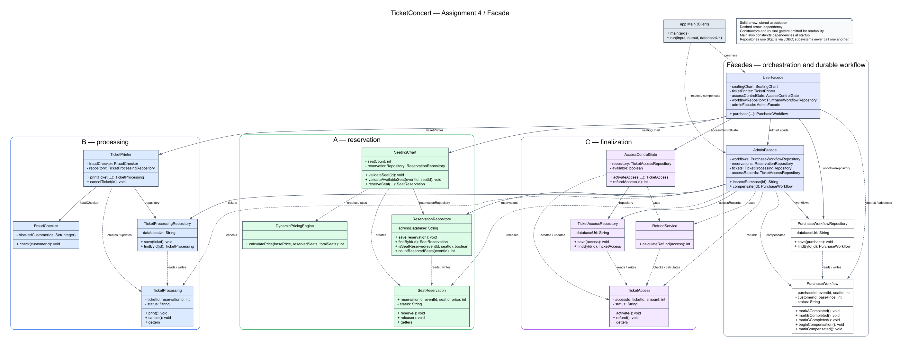

# TicketConcert — Assignment 4: Facade

Вариант 10, Concert Ticketing. Java 17+, Maven, SQLite/JDBC, JUnit 5, JaCoCo.

## Запуск

Открой проект в IntelliJ как Maven-проект. Можно запустить `app.Main` кнопкой Run.
Рабочая папка конфигурации Run — корень TicketConcert.

Или из PowerShell в корне проекта выполни одну команду:

```powershell
powershell -NoProfile -ExecutionPolicy Bypass -File .\run.ps1
```

Нужны JDK 17+ (`JAVA_HOME`) и Maven (`mvn`) в PATH. Скрипт собирает JAR и открывает меню.
База по умолчанию — `data/concert.db`. Она создаётся автоматически, сохраняется между запусками
и не удаляется командами Maven `clean` или `test`.

С другим файлом базы:

```powershell
powershell -NoProfile -ExecutionPolicy Bypass -File .\run.ps1 -DatabasePath data/demo.db
```

Сборка и прямой запуск уже собранного приложения:

```powershell
mvn clean verify
java --enable-native-access=ALL-UNNAMED -jar target/ticket-concert.jar
```

## Меню и демонстрация

| Пункт | Действие |
|---|---|
| 1 | Купить билет: A → B → C |
| 2 | Прочитать сохранённые статусы покупки и всех трёх подсистем |
| 3 | Компенсировать незавершённую покупку, включая после перезапуска |
| 4 | Покупка с реальным отказом FraudChecker для заблокированного покупателя 7 |
| 5 | Покупка с отказом недоступной системы прохода C |
| 0 | Выход |

В зале 100 мест, от 1 до 100 включительно. Для каждого нового запроса используй новый ID покупки.
ID покупки используется как ID брони, билета и доступа в их отдельных таблицах.
Номер покупателя 7 заблокирован; для успешного примера используй 20.
Если занято минимум 50% мест, цена увеличивается на 20%. В C передаётся рассчитанная цена.

### Короткий сценарий защиты на чистой базе

1. Пункт **1**: покупка **1**, концерт **10**, место **1**, покупатель **20**, цена **5000**.
   Ожидаются `COMPLETED / RESERVED / PRINTED / ACTIVE`.
2. Пункт **4**: покупка **2**, концерт **10**, место **2**, цена **5000**.
   Покупатель 7 выбирается этим сценарием автоматически. После отказа B:
   `COMPENSATED / RELEASED / NONE / NONE`.
3. Пункт **5**: покупка **3**, концерт **10**, место **3**, покупатель **20**, цена **5000**.
   После отказа C: `COMPENSATED / RELEASED / CANCELLED / NONE`.
4. Выйди через **0**, запусти приложение снова, пунктом **2** посмотри покупку **1**.
   Данные должны сохраниться.
5. Для дополнительной ошибки попробуй обычную покупку занятого места **1** на концерте **10**
   или несуществующего места **101**. Используй новый ID покупки.

Порядок статусов выше: **workflow / A / B / C**. `NONE` означает, что записи нет.
Ошибочный пункт меню или нечисловой ввод показывают сообщение и возвращают в меню.
Положительные ID и цена проверяются в CLI; существование и занятость места — в A.

### Сброс данных

Сначала закрой приложение. Затем удали только файл выбранной базы, например:

```powershell
Remove-Item -LiteralPath .\data\concert.db
```

При следующем запуске пустая база создастся заново. Для демонстрации без удаления старых данных
можно передать новый путь базы через `-DatabasePath`.

## Архитектура

```text
src/
  app/             Main — клиент и консольное меню
  reservation/     A: SeatReservation, SeatingChart, DynamicPricingEngine, ReservationRepository
  processing/      B: TicketProcessing, FraudChecker, TicketPrinter, TicketProcessingRepository
  finalization/    C: TicketAccess, AccessControlGate, RefundService, TicketAccessRepository
  Facedes/         UserFacede, AdminFacade, PurchaseWorkflow, PurchaseWorkflowRepository
test/              тесты в соответствующих пакетах
docs/              UML: uml.svg, uml.png, исходник uml.dot
```

Названия `Facedes` и `UserFacede` сохранены из исходного учебного проекта.
Подсистемы не импортируют и не вызывают друг друга. Каждая имеет свою сущность, отдельную
бизнес-логику и собственный JDBC-репозиторий. В CLI их таблицы расположены в одном SQLite-файле;
репозитории можно использовать и с отдельными файлами. Межподсистемных внешних ключей нет.

Чистая бизнес-логика: `DynamicPricingEngine` в A, `FraudChecker` в B, `RefundService` в C.
`RefundService.calculateRefund()` разрешает полный возврат только для ACTIVE и не обращается к базе.
Печать — сохранённый выпуск билета PRINTED; возврат — учёт REFUNDED и суммы.
Физический принтер и банковские переводы не подключаются.

| Сущность | Разрешённые переходы |
|---|---|
| SeatReservation | NEW → RESERVED → RELEASED |
| TicketProcessing | NEW → PRINTED → CANCELLED |
| TicketAccess | NEW → ACTIVE → REFUNDED |
| PurchaseWorkflow | PENDING_A → PENDING_B → PENDING_C → COMPLETED |
| Незавершённый PurchaseWorkflow | PENDING_A/B/C → COMPENSATING → COMPENSATED |

## Сохранение, компенсации и восстановление

`UserFacede.purchase()` сначала сохраняет workflow, затем вызывает A, B, C и сохраняет
прогресс после каждого шага. При отказе вызывает `AdminFacade.compensate()`, после чего
снова выбрасывает исходное исключение: компенсированная покупка не считается успешной.

- Отказ B после сохранения A: бронь становится RELEASED; B и C отсутствуют.
- Отказ C после сохранения A/B: сначала сохраняется CANCELLED для B, затем RELEASED для A.
- Если остановка произошла после сохранения ACTIVE, но до COMPLETED, ручная компенсация
  незавершённой покупки сначала оформляет REFUNDED для C, затем отменяет B и A.
- Перед отменой сохраняется COMPENSATING; COMPENSATED сохраняется только после всех действий.
- Компенсация читает реальные записи подсистем. Она работает даже если workflow отстал
  от уже сохранённого шага.
- После повторного открытия базы пункт **3** завершает отмену оставшихся шагов.
  CANCELLED/RELEASED/REFUNDED повторно не меняются; повторная компенсация COMPENSATED безопасна.
- COMPLETED защищён от ручной компенсации этого сценария. Это восстановление незавершённой
  цепочки, а не отмена любой завершённой продажи.
- Ошибка компенсации прикрепляется к исходной через `addSuppressed()`; сохраняется возможность
  повторить отмену после устранения причины. При недоступной базе гарантировать немедленную
  компенсацию нельзя.

Стратегия восстановления — **отмена незавершённой цепочки по запросу администратора**.
Автоматического продолжения покупки вперёд и фоновых задач нет. Это одно консольное приложение,
без параллельной обработки покупок.

## Principle of Least Knowledge: до и после

Без фасада клиенту пришлось бы знать порядок и API всех подсистем:

```java
SeatReservation reservation = seatingChart.reserveSeat(1, 10, 5, 5000);
ticketPrinter.printTicket(1, 1, 20);
accessControlGate.activateAccess(1, 1, reservation.getPrice());
// Клиенту также пришлось бы сохранять workflow и организовывать компенсации.
```

С фасадом клиент знает одну операцию:

```java
userFacede.purchase(1, 10, 5, 20, 5000);
```

Для административного сценария клиент использует второй фасад:

```java
adminFacade.inspectPurchase(1);
adminFacade.compensate(2);
```

Сборка зависимостей в Main — настройка приложения при запуске. Во время покупки клиент
не извлекает внутренние репозитории из фасада и не управляет шагами подсистем.

## Почему Facade, а не Adapter

Здесь подсистемы уже имеют подходящие API. Нам нужно дать клиенту простую операцию покупки,
которая координирует бронирование, выпуск билета, активацию доступа, сохранение прогресса
и компенсацию. Это назначение Facade: единая точка входа для сложного набора подсистем.
Adapter решал бы другую задачу — преобразование несовместимого интерфейса в ожидаемый клиентом.
У нас нет такого преобразования: фасад вызывает существующие методы в нужном порядке и
решает, какие сохранённые действия отменять при отказе. Подсистемы сохраняют самостоятельность
и отдельно используются в тестах.

## Тесты и покрытие

```powershell
mvn test
mvn clean verify
```

`test` запускает JUnit и формирует HTML-отчёт: `target/site/jacoco/index.html`.
`verify` дополнительно собирает JAR и проверяет минимум **80% покрытия строк каждого пакета**
A, B, C и Facedes. Пакет app — CLI, не включён в этот показатель; меню проверяется отдельными тестами.
Ни одна строка подсистем или фасадов из измерения не исключается.

Проверено 22.10.2026: **52 теста**, 0 failures/errors. Покрытие — **388/392 = 98,98%**.

| Пакет | Покрытие строк |
|---|---:|
| reservation | 99/101 = 98,02% |
| processing | 69/71 = 97,18% |
| finalization | 76/76 = 100% |
| Facedes | 144/144 = 100% |

Тесты обоих уровней компенсации проверяют фактически сохранённый результат; тест отказа C
проверяет порядок B → A. Есть восстановление после повторного открытия базы посередине цепочки
и после ошибки посередине компенсации. Тесты меню проверяют покупку, оба отказа, повторный запуск
и некорректный ввод. Помощник `createTicketOffice()` задаёт предметный язык подготовки сценариев.

F.I.R.S.T.: маленькие локальные сценарии, независимые временные базы `@TempDir`, повторяемые
входные данные и программные assert-проверки. Тесты и реализацию следует хранить вместе в Git;
отсутствующую историю разработки нельзя заменить выдуманными коммитами задним числом.

## UML



Векторная версия для увеличения: [uml.svg](docs/uml.svg). Исходник: [uml.dot](docs/uml.dot).
Показаны Client, оба фасада, workflow и все 12 классов подсистем.

## Перед сдачей

- Проверить `mvn clean verify` и запустить меню.
- Добавить исходники, тесты, pom.xml, run.ps1, README и docs в свой Git-репозиторий.
- Не добавлять target, локальную базу и настройки IDE; они исключены в .gitignore.
- Удалить временный учебный AGENTS.md после завершения работы с наставником.
- Сдать реальную ссылку Git-репозитория в Moodle в срок преподавателя.

Репозиторий: https://github.com/Temirlan222/Facede-software-design-pattern . Ссылку в Moodle отправляет автор проекта.
Подробная сверка с Assignment_4_Facade patterm(2).docx: [docs/assignment-checklist.md](docs/assignment-checklist.md).
